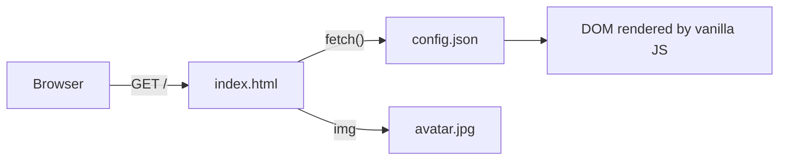

# Custom LinkTree Page

A minimal link-in-bio page. Content comes from a JSON file. No framework, no build step, no runtime dependencies.


## Overview

The site is a single `index.html` with vanilla JavaScript. On load, the script fetches `config.json` and renders the profile from it. To change the page, you edit JSON, not markup. The repository deploys to GitHub Pages as is.

Typical uses: an Instagram or TikTok bio link, a portfolio hub, a digital business card.

## Features

- **JSON-driven content.** Profile data lives in `config.json`.
- **Responsive.** Mobile-first layout that also works on desktop.
- **Automatic dark and light themes.** Follows the visitor's `prefers-color-scheme` setting.
- **Inline SVG icons.** Sharp at any size, no icon font to download.
- **CSS animations.** No animation library.
- **Optional analytics.** Google Analytics 4, inactive until you add a measurement ID.

## How it works



## Requirements

- A GitHub account
- A profile photo (square JPEG)
- For local preview only: Python 3, or any static file server

## Getting started

### 1. Get the code

```bash
git clone https://github.com/cassianorcarneiro/custom-linktree-page.git
cd custom-linktree-page
```

### 2. Edit the content

Edit `config.json`:

```json
{
  "username": "@yourname",
  "button": {
    "text": "Anonymous Messages",
    "url": "https://yourlink.com"
  }
}
```

Replace `avatar.jpg` with your own photo and keep the filename. A 400 × 400 px image is sharp on high-density screens and keeps the page light.

### 3. Preview locally

> [!IMPORTANT]
> Opening `index.html` straight from disk does not work. Browsers block `fetch()` on `file://` URLs, so `config.json` never loads and the page renders empty. Serve the folder over HTTP instead.

```bash
python3 -m http.server 8000
# open http://localhost:8000
```

### 4. Deploy to GitHub Pages

1. Push the repository to GitHub.
2. Open **Settings → Pages**.
3. Under **Build and deployment**, set **Source** to **Deploy from a branch**.
4. Select branch `main` and folder `/ (root)`, then click **Save**.
5. After a minute or two, the page is live at `https://<username>.github.io/<repository>/`.

A custom domain can be set on the same settings screen.

## Configuration

| Key | Type | Description |
|---|---|---|
| `username` | string | Handle displayed under the avatar |
| `button.text` | string | Label of the link button |
| `button.url` | string | Target URL of the link button |

The current schema supports one button. Multiple links are on the roadmap.

### Google Analytics (optional)

Replace the `G-XXXXXXXXXX` placeholder in `index.html` with your GA4 measurement ID.

> [!NOTE]
> Analytics loads Google's `gtag.js` and sets cookies. Without it, the page loads no third-party code. Under GDPR or LGPD, analytics cookies may require visitor consent.

## Performance

A visit costs three requests by default: `index.html`, `config.json` and the avatar. There are no web fonts and no third-party scripts. The avatar is usually the largest asset, so compress it before committing.

## Project structure

```
custom-linktree-page/
├── index.html     # Page markup, styles and the script that renders config.json
├── config.json    # Editable content
├── avatar.jpg     # Profile photo
├── LICENSE
└── README.md
```

## Roadmap

- [ ] Multiple links via a JSON array
- [ ] Theme colors set in `config.json`
- [ ] QR code for the page URL
- [ ] Multi-language content in `config.json`
- [ ] Preset configurations (creator, developer, freelancer)

## License

Released under the [MIT License](LICENSE).

## Author

**Cassiano Ribeiro Carneiro** · [@cassianorcarneiro](https://github.com/cassianorcarneiro)

## AI assistance

Claude (Anthropic) was used to refactor the structure and formatting of this repository. The core logic is the author's own work.
